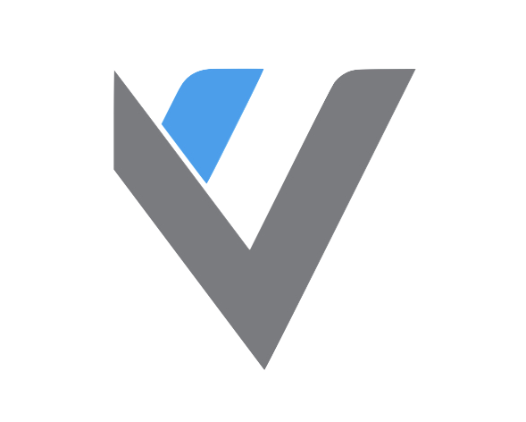
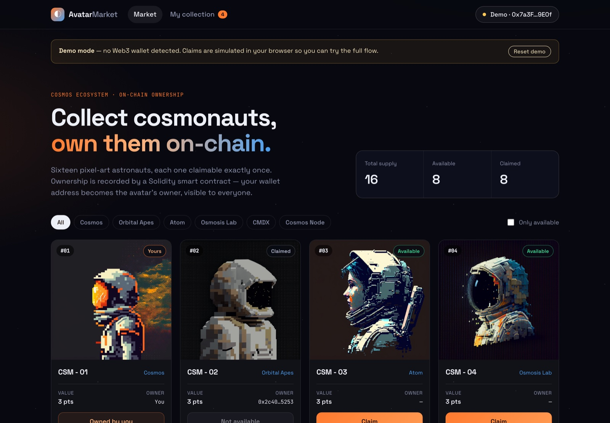
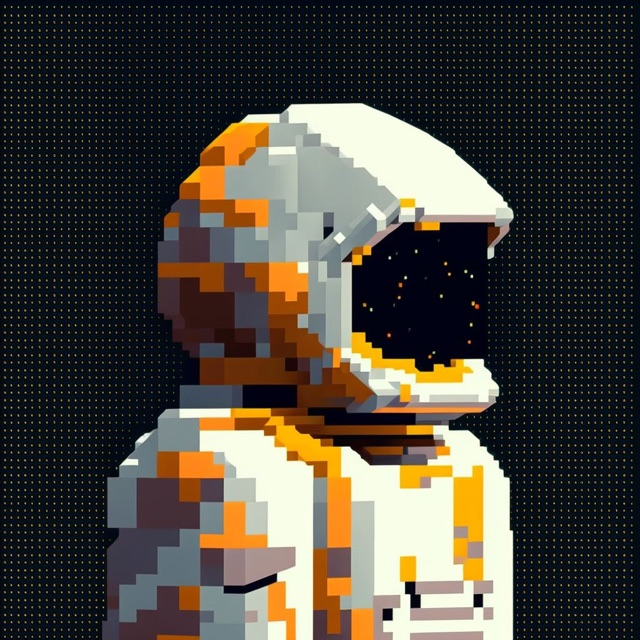
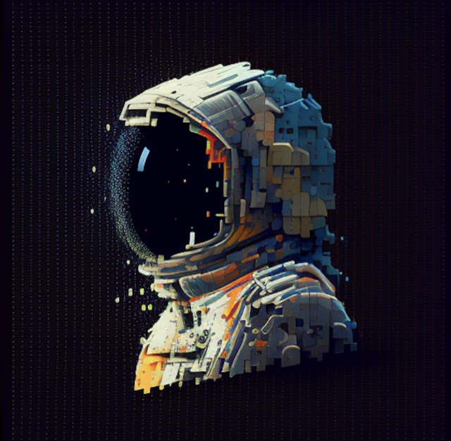
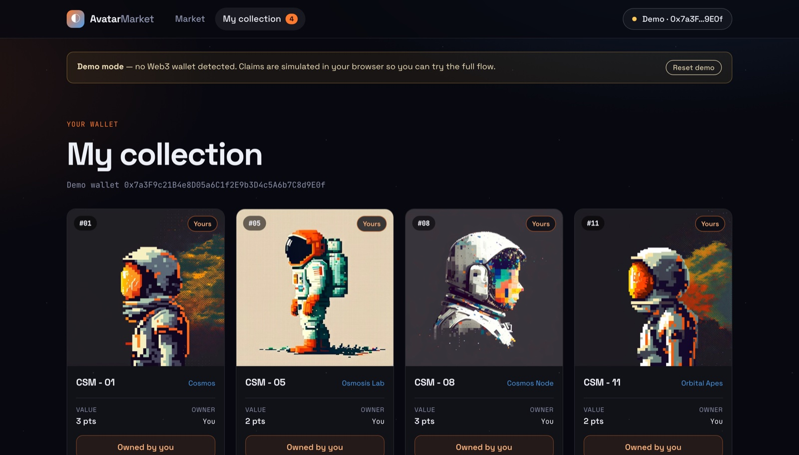
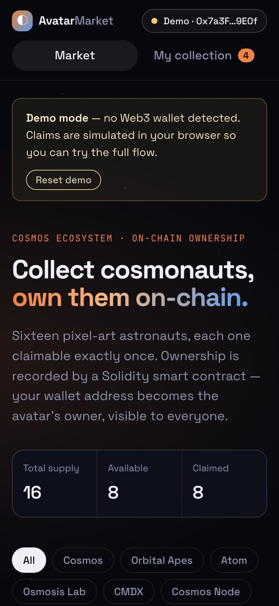
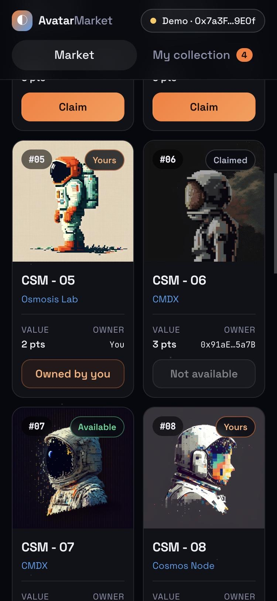

<p align="center">
  
</p>

<h1 align="center">Avatar Market</h1>

<p align="center">
  A decentralized marketplace for pixel-art cosmonaut avatars, built on an Ethereum smart contract.
</p>

<p align="center">
  <a href="https://vincenzo-esposit0.github.io/AvatarMarket/"></a>
  
  
  
</p>

<p align="center">
  
</p>

<p align="center">
  <a href="https://vincenzo-esposit0.github.io/AvatarMarket/">
    
  </a>
</p>

## Table of Contents
1. [General Info](#general-info)
2. [The collection](#the-collection)
3. [Features](#features)
4. [Screenshots](#screenshots)
5. [How it works](#how-it-works)
6. [Technologies](#technologies)
7. [Getting started](#getting-started)
8. [Live demo & deployment](#live-demo--deployment)
9. [Project structure](#project-structure)
10. [FAQs](#faqs)
11. [Presentation](#presentation)

## General Info
***
This project was created for the **Data Security** exam. Starting from the [Truffle Pet Shop tutorial](https://archive.trufflesuite.com/guides/pet-shop/), I built an avatar marketplace for the **Cosmos ecosystem**: at the time there were no markets selling images of astronauts for Cosmos, so I created a cosmonaut marketplace.

Each of the 16 avatars can be claimed **exactly once**. Ownership is recorded by a Solidity smart contract: the wallet address that claims an avatar becomes its owner, publicly visible on-chain.

## The collection
***
<p align="center">
  
  
  
  
  
  
</p>

16 pixel-art cosmonauts across six collections: *Cosmos*, *Orbital Apes*, *Atom*, *Osmosis Lab*, *CMDX* and *Cosmos Node*.

## Features
***
* 🛰️ **Marketplace**: browse all avatars, filter by collection or show only the available ones.
* 👛 **Wallet integration**: connect MetaMask (or any injected wallet) and claim an avatar with a real transaction.
* 🧑‍🚀 **My collection**: see every avatar owned by the connected address.
* 🔒 **One owner per avatar**: the contract rejects claims on avatars that are already taken.
* 🔄 **Live sync**: the page refreshes ownership automatically when other users claim avatars.
* 🧪 **Demo mode**: without a wallet, the contract is simulated in the browser so anyone can try the flow.
* 📱 **Responsive**: designed for desktop and mobile.

## Screenshots
***
<p align="center">
  
</p>

<p align="center">
  
  &nbsp;&nbsp;
  
</p>

## How it works
***
The whole marketplace logic lives in [`contracts/Adoption.sol`](contracts/Adoption.sol):

```solidity
contract Adoption {
  uint public constant SUPPLY = 16;
  address[16] public adopters;

  event Adopted(uint indexed avatarId, address indexed owner);

  function adopt(uint avatarId) public returns (uint) {
    require(avatarId < SUPPLY, "Invalid avatar id");
    require(adopters[avatarId] == address(0), "Avatar already claimed");
    adopters[avatarId] = msg.sender;
    emit Adopted(avatarId, msg.sender);
    return avatarId;
  }

  function getAdopters() public view returns (address[16] memory) { ... }
  function getOwner(uint avatarId) public view returns (address) { ... }
}
```

1. **Connect**: the front-end detects an injected wallet and looks up the contract deployment for the current network.
2. **Claim**: clicking *Claim* sends an `adopt(avatarId)` transaction, signed in the wallet.
3. **Verify**: the UI reads `getAdopters()`, a single call that returns all 16 owners, and renders who owns what.

## Technologies
***
* [Solidity](https://docs.soliditylang.org/): smart contract
* [Truffle](https://archive.trufflesuite.com/) & [Ganache](https://archive.trufflesuite.com/ganache/): compilation, migrations, tests and local blockchain
* [ethers.js v6](https://docs.ethers.org/v6/): blockchain interaction from the browser
* [MetaMask](https://metamask.io): wallet
* Vanilla HTML, CSS and JavaScript: no front-end framework or build step
* [GitHub Actions](https://docs.github.com/actions) & [GitHub Pages](https://pages.github.com): CI and hosting

## Getting started
***
**Requirements:** Node.js 18+, [Truffle](https://archive.trufflesuite.com/) (`npm install -g truffle`), [Ganache](https://archive.trufflesuite.com/ganache/) and MetaMask.

1. Install the dependencies.
    ```bash
    npm install
    ```

2. Start Ganache (GUI, RPC on `127.0.0.1:7545`), then compile and deploy the contract.
    ```bash
    npm run migrate
    ```
    Alternatively, run `truffle develop` and type `migrate` in its console.

3. Start the development server on http://localhost:3000.
    ```bash
    npm run dev
    ```

4. In MetaMask, add the Ganache network (RPC `http://127.0.0.1:7545`, chain ID `1337`) and import one of its accounts using the private key shown in Ganache.

The front-end reads the local contract address from `build/contracts/Adoption.json`. After changing the contract, run `npm run migrate` again.

### Running the tests
```bash
npm test
```
The suite (Solidity + JavaScript) checks claiming, ownership lookups, the `Adopted` event, and that already claimed avatars and invalid ids are rejected.

## Live demo & deployment
***
The site is published to **GitHub Pages** by [`.github/workflows/pages.yml`](.github/workflows/pages.yml): on every push to `main` it runs the contract tests and, if they pass, deploys the `src/` folder.

> First-time setup: in the repository go to **Settings → Pages → Source** and select **GitHub Actions**.

The front-end runs in two modes:
* **Demo mode** is used when there is no wallet, or the wallet is on a network without a deployment. The contract rules are simulated in the browser (`localStorage`).
* **Live mode** is used when the wallet is on a network with a known deployment. Ownership is read from and written to the real contract.

**Deploying on the Sepolia testnet (optional)**
1. Get some Sepolia test ETH from a faucet in MetaMask.
2. Open [Remix](https://remix.ethereum.org), paste `contracts/Adoption.sol`, compile it with Solidity 0.5.16 and deploy it with *Injected Provider – MetaMask* on Sepolia.
3. Add the contract address to [`src/js/config.js`](src/js/config.js):
    ```js
    deployments: {
      11155111: "0xYourContractAddress",
    },
    ```
4. Push to `main`. Visitors whose wallet is on Sepolia will use the real contract; the others get a one-click *Switch to Sepolia* button.

## Project structure
***
```
contracts/          Solidity contracts (Adoption, Migrations)
migrations/         Truffle deployment scripts
test/               Solidity and JavaScript tests
src/                Static front-end (published to GitHub Pages)
├── index.html      Market and My collection views
├── avatar.json     Avatar metadata
├── css/style.css
├── js/app.js       Wallet, contract and demo logic
├── js/config.js    Public contract deployments by chain ID
└── images/avatars/ Optimized avatar images
docs/images/        README images
```

## FAQs
***
**Q: What is the purpose of this project?**<br>
A: To build an avatar marketplace for the Cosmos ecosystem, where users can claim images of astronauts and own them on-chain.

**Q: What was the starting point for the project?**<br>
A: The Pet Shop tutorial from the Truffle Framework, turned into a cosmonaut marketplace.

**Q: Do I need a wallet or crypto to try it?**<br>
A: No. Without a wallet the live demo runs in demo mode, which simulates the contract in your browser. To make real transactions you need MetaMask and a network where the contract is deployed (e.g. Ganache locally, or Sepolia with free test ETH).

**Q: Can someone take an avatar I already own?**<br>
A: No. `adopt()` reverts with *"Avatar already claimed"* if the avatar has an owner, and the tests cover this case.

**Q: Is this project related to the Data Security exam?**<br>
A: Yes, this project was created for the Data Security exam.

## Presentation
***
> [Avatar Market on Canva](https://www.canva.com/design/DAFbfoMfouI/cTtr1SxfRTxtbDW4hJsazQ/view)


